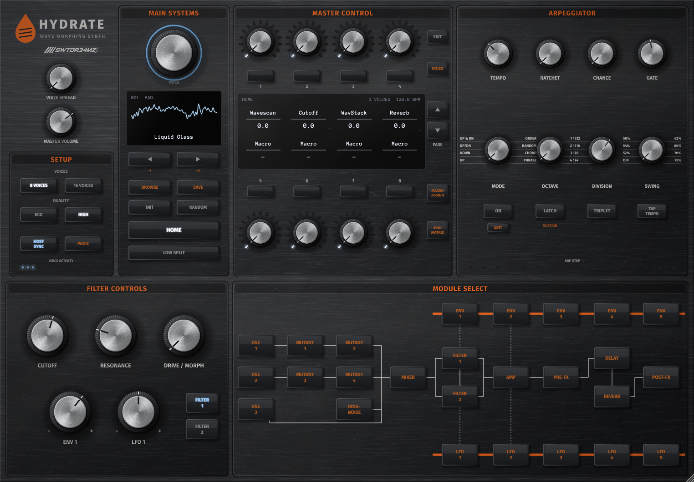

# HYDRATE

A wave-morphing polysynth in the manner of the ASM **Hydrasynth**, as a **VST3** for Windows and a **standalone
app**. 8 or 16 voices (switchable). By **swtdr34mz**.

Unofficial: not made, endorsed or supported by Ashun Sound Machines. The waves, filters, effects, phrases and
factory patches are HYDRATE's own, built after the Hydrasynth's architecture as its owner's manual (2.2.0)
describes it.



## Download

[Actions](https://github.com/swtdr34mz-afk/HYDRATE/actions) → the newest green run → **Artifacts** at the bottom:
`HYDRATE-Windows` (a GitHub sign-in is needed for artifacts). Releases (tags `v*`) carry the same zip.

## Installieren (kurz auf Deutsch)

1. Zip entpacken.
2. Den Ordner `HYDRATE.vst3` nach `C:\Program Files\Common Files\VST3\` kopieren.
3. Cubase starten (oder *Studio → VST-PlugIn-Manager → Aktualisieren*). HYDRATE steht unter den Instrumenten,
   Hersteller swtdr34mz.
4. `HYDRATE.exe` ist die Standalone-App (Audio und MIDI unter *Options*).

Eigene Patches (SAVE) landen in `Dokumente\HYDRATE\Patches`.

## What it has

- **Three oscillators** per voice with **219 waves** in the Hydrasynth's 34 groups (Classic, Pulse, Horizon …
  SquRoo, Harmon), band-limited at every pitch. Osc 1 and 2: **WaveScan** through a list of up to eight waves
  (OFF, Silence). Semi, Cents, Keytrack, **BitRedux**.
- **Four Mutants** (two in series after osc 1 and after osc 2), each **FM-Lin** (Sine, Triangle, Osc 1-3, Ring,
  Noise, Mutant 1-4 as source), **WavStack**, **OSC Sync** (Ratio, Window), **PW-Orig**, **PW-Sqeez**, **PW-ASM**
  (eight Warp points), **Harmonic**, **PhazDiff**; Ratio 0.25-64, Depth, Feedback 0-150 %, Dry/Wet.
- **Ring-Noise**: ring modulator (two of eight sources, Depth), noise in seven colours.
- **Mixer**: level, pan and filter ratio for each source; filters in **Series** or **Parallel**.
- **Filter 1**: 16 types (LP Ldr12/24, LP Fat12/24, LP Gate, LP/HP MS20, LP/BP/HP 3-Ler, LP/BP/HP Stn12, LP 1 Pole,
  LP 8 Pole, Vowel with Control and Vowel Order), Drive pre/post. **Filter 2**: 12 dB state-variable, morphing
  LP-BP-HP or LP-Notch-HP. Both stereo, with ENV 1, LFO 1, Vel Env and Keytrack.
- **Amp** (ENV 2, LFO 2, velocity, level), **5 DAHDSR envelopes** (curves, loop, BPM sync, quantize, legato, reset,
  freerun, four trigger sources, tap), **5 LFOs** (11 waves, 64-step Step LFO with SemiLock, BPM sync, Poly /
  Single / Off, delay, fade, phase, smooth, quantize, one-shot and step advance), vibrato on the mod wheel.
- **Mod Matrix** with 32 slots (the manual's sources and destinations, MIDI CCs too), **8 Macros** with 8
  destinations each (knob depth and button value).
- **Voice**: Poly, Mono / MonoLo / MonoHi, Unison / UnisonLo / UnisonHi (Density, Detune), Stereo Mode and Width,
  Analog Feel, Random Phase, **Warm Mode**, Snap, Glide / Glissando, 38 scales with Key Lock, Sustain / Sostenuto /
  Mod Only, VoiceMod.
- **Arpeggiator**: Up, Down, Up/Dn, Up & Dn, Order, Random, Chord, Phrase (64), octave modes, Ratchet, Chance,
  Swing, Gate, Length, Step Offset, Latch, Clock Lock; follows the DAW's tempo (HOST SYNC).
- **Effects**: Pre-FX and Post-FX (Chorus, Flanger, Rotary, Phaser, Lo-Fi, Tremolo, EQ, Compressor, Distort, with
  their presets), Delay (Basic Mono / Stereo, Pan, LRC, Reverse), Reverb (Hall, Room, Plate, Cloud; Freeze).
- **8 or 16 voices** (SETUP), **QUALITY** HIGH (voices at 2x the rate) or ECO.
- **VOICE SPREAD** (above MASTER VOLUME): spreads the voices across the stereo field, with a little detune
  (up to ±7 cents) and filter variation per note. Saved with the project, not the patch.
- **LOW SPLIT** (MAIN SYSTEMS): switch it on and play a key: everything below that key plays one mono bass voice of
  its own (legato, last note), the keys from there up play the patch as usual (also through the arp). The split note
  shows in the display. Press again to switch it off.

## The panel

As on the instrument: **MODULE SELECT** opens a module's pages in the **MASTER CONTROL** display, the eight
encoders turn the eight fields, **PAGE** turns the pages (or press the module's button again), the buttons above
and below the display do what the field's button does (Edit…, on/off, Tap). **HOME** shows the macros,
**VOICE**, **MACRO ASSIGN**, **MOD MATRIX** and the arp's **EDIT** their pages. In the mod matrix a field's button
switches its encoder between source and destination. **FILTER CONTROLS** work on Filter 1 or Filter 2.

Mouse: drag a knob up / down (Shift: fine), the wheel turns it, a double-click resets it; a click on a display
field opens its list (waves by group, sources, destinations, types). The patch encoder and ◀ ▶ step through the
patches, BROWSE lists them by category.

## Building

```
cmake -B build -DCMAKE_BUILD_TYPE=Release
cmake --build build --config Release
```
JUCE 8 comes from GitHub. The engine's tests: `cmake -S tests -B build-tests && cmake --build build-tests &&
build-tests/engine_tests`.

## License

MPL-2.0. Fonts: Fira Sans and Anonymous Pro (SIL OFL, see `fonts/`).
